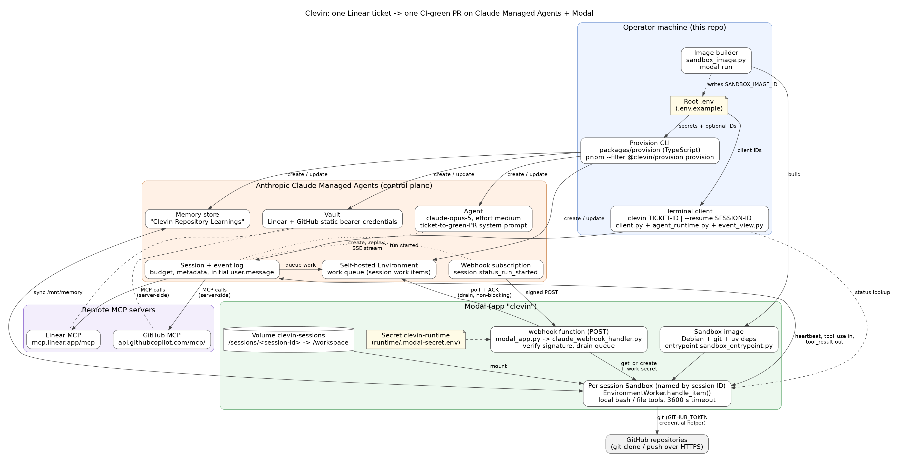

# Clevin

Clevin is a research experiment that runs a single coding agent on
[Claude Managed Agents](https://platform.claude.com/docs/en/managed-agents/self-hosted-sandboxes)
primitives. Given one Linear ticket ID, the agent fetches the ticket, picks one
GitHub repository, implements the change in a self-hosted
[Modal](https://modal.com) sandbox, opens a pull request and keeps fixing it
until the required CI checks are green.

The repository has two parts:

| Path | Language | What it does |
| --- | --- | --- |
| [`packages/provision`](packages/provision) | TypeScript (pnpm) | Creates or updates the Anthropic resources: Agent, self-hosted Environment, Memory store, Vault and its Linear/GitHub credentials. |
| [`runtime`](runtime) | Python 3.13 (uv) | Modal webhook dispatcher, per-session sandbox worker, sandbox image, and the `clevin` terminal client. |
| [`context`](context) | Markdown | Research notes and planning documents (the loop investigation, the swarm plan and prompt). |

See [docs/architecture.md](docs/architecture.md) for how the pieces fit together.



The diagram source is [docs/diagrams/architecture.dot](docs/diagrams/architecture.dot)
(Graphviz). Edit it and run [`docs/diagrams/render.sh`](docs/diagrams/render.sh) to
refresh the [PNG](docs/diagrams/architecture.png) and
[SVG](docs/diagrams/architecture.svg).

## Prerequisites

- Node.js 22 or later and pnpm 11 (`packageManager` pins `pnpm@11.23.0`; `corepack enable` picks it up).
- Python 3.13 and [uv](https://docs.astral.sh/uv/).
- An Anthropic API key with Managed Agents access, a Linear API key and a GitHub token.
- A Modal account with the Modal CLI authenticated (`uv run --project runtime modal setup`).

## Install and verify

```bash
pnpm install
uv sync --project runtime

# TypeScript: Biome format + lint, tsc, Vitest
pnpm verify

# Python: Ruff format + lint, mypy --strict, pytest
uv run --project runtime ruff format --check runtime \
  && uv run --project runtime ruff check runtime \
  && uv run --project runtime mypy runtime/src \
  && uv run --project runtime pytest -c runtime/pyproject.toml
```

All tests use fakes; none of them call Anthropic, Modal, Linear or GitHub.

## Set up and run

These steps create real cloud resources. They follow [AGENTS.md](AGENTS.md).

1. Copy `.env.example` to `.env` and fill in `ANTHROPIC_API_KEY`, `GITHUB_TOKEN`
   and `LINEAR_API_KEY`. Leave the resource IDs empty on the first run.
2. Provision the Anthropic resources:
   `pnpm --filter @clevin/provision provision`. It prints a JSON manifest of
   the resource IDs; copy them into `.env` (`CLEVIN_AGENT_ID`,
   `CLEVIN_AGENT_VERSION`, `CLEVIN_ENVIRONMENT_ID`, `CLEVIN_VAULT_ID`,
   `CLEVIN_LINEAR_CREDENTIAL_ID`, `CLEVIN_GITHUB_CREDENTIAL_ID`,
   `CLEVIN_MEMORY_STORE_ID`). Running it again with the IDs set updates the
   same resources instead of creating new ones.
3. In Claude Console, generate the Environment key for the self-hosted
   Environment and store it; the API cannot return it later.
4. Build the sandbox image:
   `uv run --project runtime modal run runtime/src/clevin_runtime/sandbox_image.py`.
   It prints `SANDBOX_IMAGE_ID` and writes it into `.env` when `.env` exists.
5. Create the Modal secret file and secret:
   `install -m 600 runtime/.env.example runtime/.modal-secret.env`, fill in
   `ANTHROPIC_ENVIRONMENT_ID`, `ANTHROPIC_ENVIRONMENT_KEY`, `SANDBOX_IMAGE_ID`
   and `GITHUB_TOKEN`, then
   `uv run --project runtime modal secret create clevin-runtime --from-dotenv runtime/.modal-secret.env --force`.
6. Deploy the webhook:
   `uv run --project runtime modal deploy runtime/src/clevin_runtime/modal_app.py --env clevin`.
7. Register the Modal URL in Anthropic as a webhook for
   `session.status_run_started`, add its signing secret as
   `ANTHROPIC_WEBHOOK_SECRET` to `runtime/.modal-secret.env`, and rerun steps 5
   (secret create) and 6 (deploy).
8. Start a ticket session: `uv run --project runtime clevin ENG-123`.
   Resume or replay one later with
   `uv run --project runtime clevin --resume SESSION-ID`.

The client prints a resource table (Agent, Environment, Session, Modal
Sandbox and Volume), streams the session's events, and prints the final status,
usage and budget. Pressing Ctrl+C disconnects the client only; the remote
session keeps running.

## Configuration

| Variable | Read by | Required |
| --- | --- | --- |
| `ANTHROPIC_API_KEY` | provision, `clevin` client | yes |
| `GITHUB_TOKEN`, `LINEAR_API_KEY` | provision (stored in the Vault) | yes |
| `CLEVIN_AGENT_ID` + `CLEVIN_AGENT_VERSION` | provision (both or neither), client (version optional: unset uses the latest) | client: ID yes |
| `CLEVIN_ENVIRONMENT_ID`, `CLEVIN_VAULT_ID`, `CLEVIN_MEMORY_STORE_ID` | provision (optional), client (required) | client: yes |
| `CLEVIN_LINEAR_CREDENTIAL_ID`, `CLEVIN_GITHUB_CREDENTIAL_ID` | provision | no |
| `ANTHROPIC_WORKSPACE_ID` | client, for Claude Console links | no |
| `MODAL_WORKSPACE_SLUG` | client, for Modal dashboard links | no |
| `ANTHROPIC_ENVIRONMENT_ID`, `ANTHROPIC_ENVIRONMENT_KEY`, `ANTHROPIC_WEBHOOK_SECRET`, `SANDBOX_IMAGE_ID`, `GITHUB_TOKEN` | Modal webhook, via the `clevin-runtime` secret | yes |

Values in the process environment override the root `.env` file.
