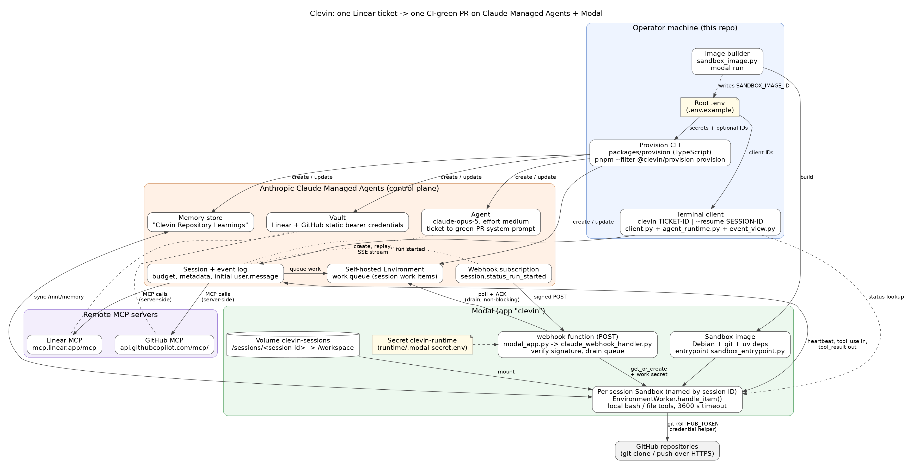

# Clevin architecture

Clevin runs one Claude Managed Agents session per Linear ticket. Anthropic's
control plane owns the agent, the session state and model runs; Modal runs the
agent's local tools in a self-hosted sandbox; this repository provisions the
Anthropic resources, dispatches work into Modal and gives the operator a
terminal client.

Diagram source: [diagrams/architecture.dot](diagrams/architecture.dot), rendered
by [diagrams/render.sh](diagrams/render.sh) to [PNG](diagrams/architecture.png)
and [SVG](diagrams/architecture.svg). Graphviz is required to re-render.

## Components

### Provisioning (`packages/provision`, TypeScript)

| File | Role |
| --- | --- |
| [`src/agent-definition.ts`](../packages/provision/src/agent-definition.ts) | The Agent: model `claude-opus-5` at `medium` effort, the ticket-to-green-PR system prompt (with a `CLEVIN_SMOKE_TEST` read-only branch), the native `agent_toolset_20260401`, and the Linear (`https://mcp.linear.app/mcp`) and GitHub (`https://api.githubcopilot.com/mcp/`) MCP servers, all `always_allow`. The prompt forbids custom tools, subagents and work outside the one chosen repository. |
| [`src/config.ts`](../packages/provision/src/config.ts) | Loads the root `.env` (process env wins), requires `ANTHROPIC_API_KEY`, `GITHUB_TOKEN`, `LINEAR_API_KEY`, and validates optional resource IDs by prefix (`agent_`, `env_`, `vlt_`, `vcrd_`, `memstore_`). |
| [`src/resources.ts`](../packages/provision/src/resources.ts) | Reconciles each resource: create when its ID is unset, otherwise retrieve and update. The Environment must be `self_hosted`; the Agent update uses the retrieved version and fails if `CLEVIN_AGENT_VERSION` is stale; credentials must be `static_bearer` for the exact MCP URL. |
| [`src/provision.ts`](../packages/provision/src/provision.ts) | Entry point (`pnpm --filter @clevin/provision provision`). Prints a non-secret JSON manifest of resource IDs plus the manual next step (generate the Environment key in Claude Console). |

Resources created: Agent, self-hosted Environment ("Clevin Modal Self-Hosted
Environment"), Memory store ("Clevin Repository Learnings"), Vault ("Clevin
MCP Credentials") with one Linear and one GitHub static bearer credential.

### Runtime (`runtime/src/clevin_runtime`, Python)

| Module | Runs where | Role |
| --- | --- | --- |
| [`config.py`](../runtime/src/clevin_runtime/config.py) | everywhere | Names (`clevin` app, `clevin-runtime` secret, `clevin-sessions` volume), paths (`/workspace`, `/mnt/memory`), timeouts (sandbox 3600 s, worker idle 120 s) and typed settings: `ClientSettings` (root `.env` + env), `DeploymentSettings` (env only, inside Modal), `LocalSettings`. |
| [`modal_app.py`](../runtime/src/clevin_runtime/modal_app.py) | Modal | Deploys `webhook`, a POST FastAPI endpoint (300 s timeout) with the `clevin-runtime` secret, which calls `handle_webhook`. |
| [`claude_webhook_handler.py`](../runtime/src/clevin_runtime/claude_webhook_handler.py) | Modal | Verifies the Anthropic webhook signature (401 on failure), ignores every event except `session.status_run_started`, then drains the Environment's work queue with `block_ms=None`, `reclaim_older_than_ms=2000`, `drain=True`, `auto_stop=False`. For each session work item it calls `SandboxRuntime.get_or_create` and returns a per-item result (or the error type name). |
| [`sandbox_runtime.py`](../runtime/src/clevin_runtime/sandbox_runtime.py) | Modal and client | Finds a live sandbox by session-ID name, or creates one from `SANDBOX_IMAGE_ID` with the `clevin-sessions` volume subpath `/sessions/<session-id>` mounted at `/workspace`, the environment key, work secret and GitHub token as a Modal secret, and termination grace enabled. Also builds Modal dashboard links for the client. |
| [`sandbox_image.py`](../runtime/src/clevin_runtime/sandbox_image.py) | operator → Modal | Defines the sandbox image (Debian slim, Python 3.13, git and archive tools, the runtime's uv dependencies, `/mnt/memory` and `/workspace`), entrypoint `sandbox_entrypoint.py`. `modal run` builds it and writes `SANDBOX_IMAGE_ID` into `.env`. |
| [`sandbox_entrypoint.py`](../runtime/src/clevin_runtime/sandbox_entrypoint.py) | sandbox | Installs a git credential helper that answers only for `github.com` with `GITHUB_TOKEN`, then runs the SDK's `EnvironmentWorker.handle_item()` for its one work item (`max_idle=120`, `memory_sync_deletions="log_only"`). SIGINT/SIGTERM cancel the worker. |
| [`agent_runtime.py`](../runtime/src/clevin_runtime/agent_runtime.py) | client | Validates the ticket ID (`TEAM-123`), creates the session (pinned or latest Agent version, Environment, Vault, read-write Memory store, budget `max_list_cost` `{"amount": "500", "currency": "USD"}`, metadata, initial ticket message), replays the event log and streams new events without duplicates. |
| [`event_view.py`](../runtime/src/clevin_runtime/event_view.py) | client | Reduces events into status, stop reason, usage and budget; a session is terminal when it is `terminated` or idle for any reason other than `requires_action`. Redacts secret-looking keys and token patterns before printing. |
| [`client.py`](../runtime/src/clevin_runtime/client.py) | client | The `clevin` console script: `clevin TICKET-ID` or `clevin --resume SESSION-ID`. Prints the resource table, replays and streams events, then prints final status, usage and budget, and the resume command. |

## Request flow

1. **Start.** `clevin ENG-123` creates a session for the Agent in the self-hosted
   Environment. Anthropic queues one session work item and moves the session
   to `running`.
2. **Wake up.** Every transition to `running` sends a signed
   `session.status_run_started` webhook to the Modal `webhook` function. The
   webhook is only a wake-up: the handler ignores the triggering session ID and
   drains whatever work the shared queue holds.
3. **Claim and launch.** The poller claims and ACKs each work item (which
   carries the per-session work secret) and the handler creates, or reuses, a
   Modal Sandbox named after the session. The HTTP call returns once the
   sandbox is launched; the sandbox runs detached.
4. **Tool loop.** Inside the sandbox the worker heartbeats the lease, receives
   `agent.tool_use` events over the session stream, runs local bash and file
   tools in `/workspace` (the session's volume), and posts tool results.
   The Memory store is synced to `/mnt/memory`. Git uses `GITHUB_TOKEN` through
   the credential helper.
5. **MCP tools.** Linear and GitHub MCP calls run in Anthropic's control plane
   with the Vault credentials, not in the sandbox.
6. **Repeat wake-ups.** Each later run start sends another webhook; the queue is
   empty because the first sandbox owns the session, so those calls return
   `spawned: []`.
7. **Finish.** The agent stops after CI is green (or the budget stops it). The
   worker exits 120 s after an `end_turn` idle; the client sees the terminal
   status and prints usage and budget.

[context/clevin-agent-loop-investigation.md](../context/clevin-agent-loop-investigation.md)
has the full protocol sequence and the runtime evidence behind it.

## State and secrets

| Where | What |
| --- | --- |
| Root `.env` (git-ignored) | Operator secrets and resource IDs for provisioning and the client; `SANDBOX_IMAGE_ID` written by the image build. |
| `runtime/.modal-secret.env` (git-ignored, mode 0600) | Source for the Modal secret `clevin-runtime` used by the webhook. |
| Anthropic | Agent versions, Environment and its queue, sessions and event logs, Vault credentials, Memory store. |
| Modal | App `clevin`, its webhook function, per-session sandboxes, and the `clevin-sessions` volume (one subpath per session). |

## Testing

`pnpm verify` runs Biome format and lint, `tsc --noEmit` and Vitest (8 tests in
`packages/provision/test/provision.test.ts`: the agent definition, config
parsing, create/update reconciliation, stale-version and wrong-URL rejection,
and the manifest). The Python check runs Ruff, `mypy --strict` and pytest (32
tests in `runtime/tests/` covering config, session creation and replay, event
reduction and redaction, sandbox naming and reuse, webhook verification and
filtering, and work-secret forwarding). All tests use fakes and need no
credentials or network. There is no CI workflow in the repository.

## Known limitations

These come from the code and the loop investigation in `context/`:

- `EnvironmentWorker` only applies the idle timer after `end_turn`, so a
  session that stops on `budget_reached` keeps its sandbox until the 3600 s
  sandbox timeout.
- Webhook deliveries are at least once; the handler neither logs nor
  deduplicates the webhook event ID, so retries cause extra (harmless) empty
  drains.
- One agent works in exactly one repository per ticket; there are no
  subagents, custom tools or browser.
